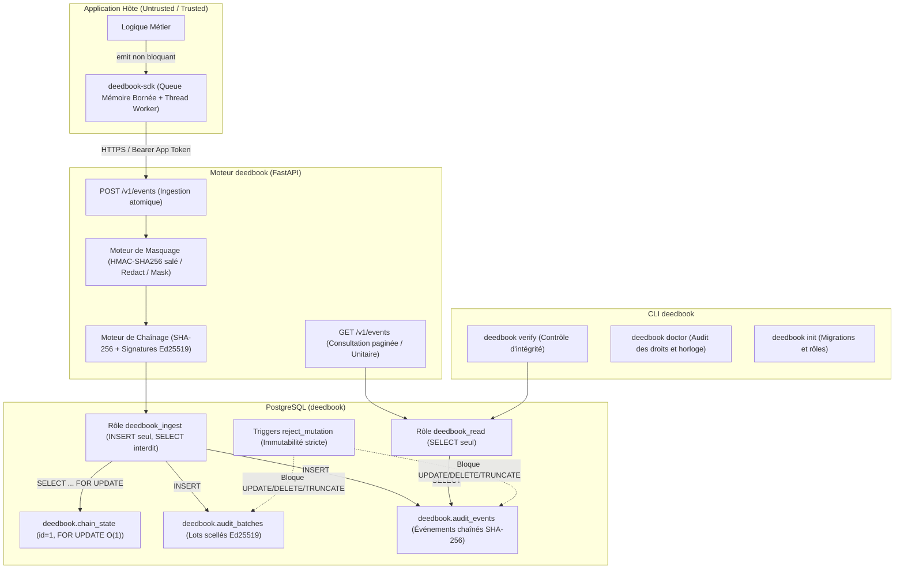

# deedbook

Moteur d'audit et de gouvernance pour bases de données **PostgreSQL**, usage personnel.

## État

- **V0 (Noyau)** : Implémenté et validé.
  - Ingestion d'événements et de lots atomiques (`POST /v1/events`).
  - Validation Pydantic stricte (schéma v1.0, typage, immutabilité).
  - Masquage des champs sensibles (redact, hash HMAC-SHA256 salé, mask).
  - Contrôle d'accès et authentification par jetons applicatifs et admin.
  - Rôles PostgreSQL à moindres privilèges (`deedbook_ingest` INSERT-seul, `deedbook_read` SELECT-seul).
  - Consultation unitaire (`GET /v1/events/{id}`) et recherche multi-critères avec pagination (`GET /v1/events`).
  - SDK Python (`deedbook-sdk`) garantissant le zéro plantage de l'application hôte.
- **V1 (Preuve & Intégrité cryptographique)** : Implémenté et validé.
  - Chaînage cryptographique continu SHA-256 (`integrity_seq`, `prev_hash`, `event_hash`).
  - Verrou exclusif d'état en $O(1)$ (`chain_state`) sérialisant l'ordre sans trou de séquence.
  - Signatures numériques asymétriques Ed25519 scellant chaque lot d'ingestion (`audit_batches`).
  - Commande CLI `deedbook verify` vérifiant de bout en bout l'intégrité du registre.
  - Suite de tests d'attaque complète ATK-01 à ATK-10 validant la résilience et l'immutabilité.
- **Feuille de route** : V0 noyau (achevé) → V1 preuve cryptographique (achevé) → V2 administration & ancrage externe → V3 gouvernance.

## Architecture



*Pour le détail des flux transactionnels et de la topologie cryptographique, voir le [Guide d'Architecture](docs/architecture.md).*

## Structure

| Chemin | Rôle |
|---|---|
| `server/` | Moteur FastAPI (`deedbook`) : ingestion, recherche, masquage, CLI |
| `sdk-python/` | Kit d'intégration client Python (`deedbook-sdk`) : zéro plantage hôte |
| `deploy/` | `docker-compose.yml`, conteneur Postgres + pgAudit |
| `docs/` | Spécification formelle v1.0, modèle de menace et décisions d'architecture (ADR) |
| `deedbook.toml` | Politique du projet (sans secret) |
| `.env.example` | Modèle de variables d'environnement (le vrai `.env` reste strictement hors Git) |

## Démarrage rapide

```bash
# 1. Configuration des secrets
cp .env.example .env

# 2. Démarrage de la base PostgreSQL
docker compose -f deploy/docker-compose.yml --env-file .env up -d db

# 3. Installation et vérification de l'environnement
cd server && uv sync
uv run deedbook init     # applique les migrations et configure les rôles
uv run deedbook doctor   # vérifie la configuration, les droits réels et l'horloge

# 4. Enregistrement d'une application
uv run deedbook project add monapp

# 5. Démarrage du serveur API
uv run deedbook serve --port 8000
```

## Documentation

- [Guide d'architecture technique](docs/architecture.md) : composants, séquence d'ingestion transactionnelle et topologie cryptographique SHA-256 / Ed25519.
- [Spécification de l'événement d'audit v1.0](docs/specification-evenement-audit.md) : format JSON, validation, règles d'action et masquage.
- [Modèle de menace](docs/modele-de-menace.md) : scénarios S1 à S6 et plan de tests d'attaque ATK-01 à ATK-10.
- [Journal des décisions d'architecture (ADR)](docs/adr/) : décisions structurantes D001 à D009.

## Règles fondamentales

- **Secrets exclusivement en variables d'environnement** (`.env`), politique sans secret dans `deedbook.toml`.
- **Rôles à moindres privilèges** : le rôle d'ingestion ne possède aucun droit de modification ou de lecture des tables d'audit.
- **Contrat zéro plantage hôte** : le SDK Python intercepte toute exception sans jamais faire échouer l'application hôte.
- **Immuabilité** : triggers de base interdisant `UPDATE`, `DELETE` et `TRUNCATE` sur les tables d'audit. Les migrations appliquées ne sont jamais modifiées.
- **Hook anti-secrets actif** : `git config core.hooksPath .githooks`.
