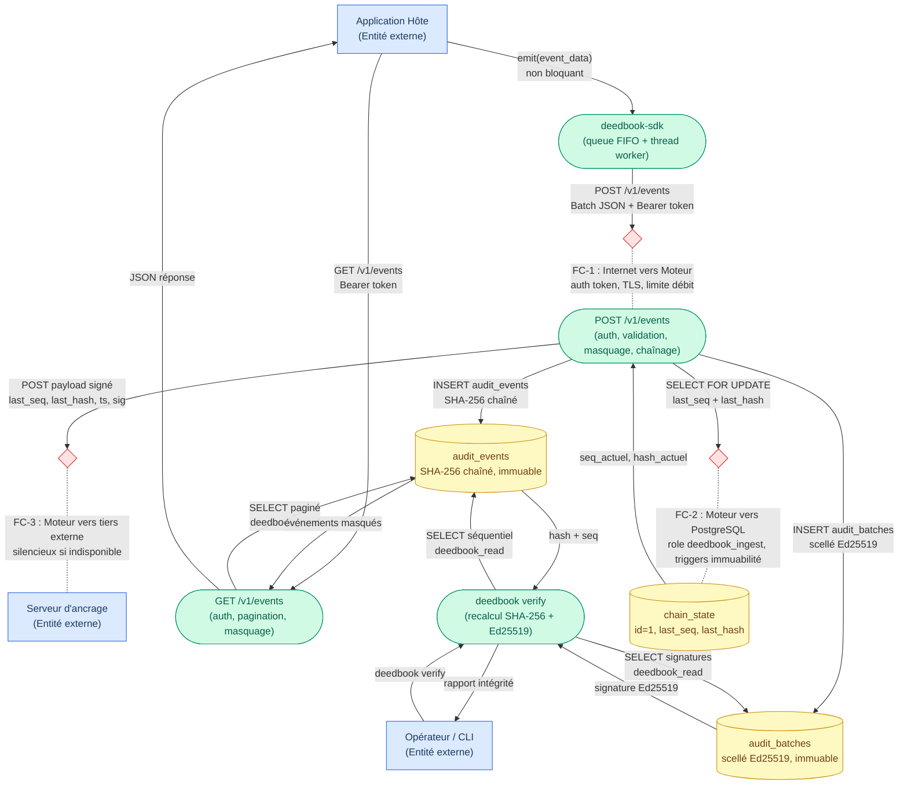
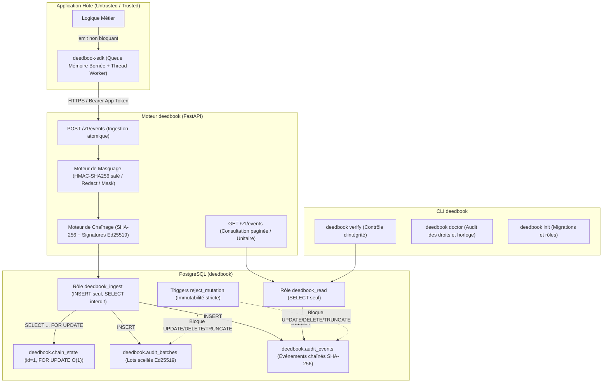
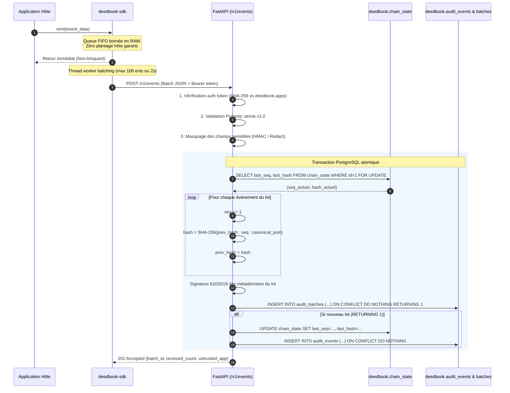
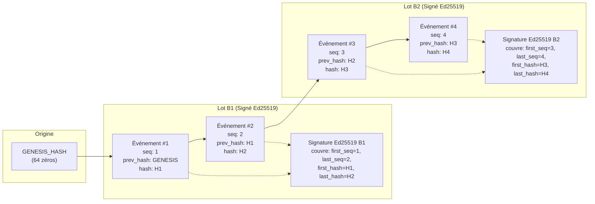

# Architecture Système de deedbook

Ce document décrit l'architecture technique, les frontières de confiance, le cycle transactionnel d'ingestion et le modèle cryptographique de **deedbook**.

---

## 1. Diagramme de Flux de Données (DFD)

Le DFD représente les quatre éléments canoniques : **entités externes** (rectangles), **processus** (coins arrondis), **magasins de données** (lignes parallèles) et **flux de données** (flèches étiquetées), ainsi que les **frontières de confiance** (pointillés) là où les données franchissent un niveau de privilège différent.

> Les frontières de confiance indiquent où appliquer STRIDE : validation des entrées, authentification des appelants et contrôle des privilèges.



### Frontières de confiance et STRIDE

| Frontière | Description | STRIDE prioritaire |
|---|---|---|
| **FC-1** : App vers Moteur | Données non fiables entrent via HTTPS. Le token Bearer identifie l'appelant. | Spoofing (auth token), Tampering (validation Pydantic), DoS (100 evts / 256 Ko) |
| **FC-2** : Moteur vers PostgreSQL | Changement de privilège vers le rôle `deedbook_ingest` (INSERT seul). Les triggers bloquent toute mutation. | Tampering (triggers immuabilité), Elevation (moindre privilège) |
| **FC-3** : Moteur vers tiers externe | Flux sortant optionnel. L'ingestion n'est jamais bloquée si le serveur d'ancrage est indisponible. | Repudiation (preuve temporelle tierce), DoS (tolérance panne réseau) |

---

## 2. Vue d'Ensemble des Composants & Relations

`deedbook` isole strictement les responsabilités entre l'application émettrice, l'API d'ingestion et de consultation, et la base de données PostgreSQL durcie.



### Frontières de sécurité fondamentales

1. **Contrat Zéro Plantage Hôte** : Le SDK Python s'exécute dans l'application cliente. Il utilise une file d'attente FIFO bornée (`maxsize=10000`) et un thread démon d'arrière-plan. Toute panne réseau ou indisponibilité du serveur `deedbook` est absorbée silencieusement sans jamais bloquer ou faire échouer l'application hôte.
2. **Moindres Privilèges PostgreSQL** :
   - Le rôle `deedbook_ingest` ne dispose d'aucun privilège de lecture (`SELECT`) sur les tables `audit_events` et `audit_batches`. Il ne peut ni lire ce qui a été journalisé, ni altérer l'historique existant.
   - Le rôle `deedbook_read` ne dispose que du privilège de consultation (`SELECT`) et ne peut exécuter aucune écriture ou modification.
3. **Immuabilité Applicative et Base** : Des triggers PL/pgSQL (`reject_mutation`) interdisent toute opération `UPDATE`, `DELETE` ou `TRUNCATE` sur les tables du registre, y compris pour le compte d'administration.

---

## 3. Cycle Transactionnel d'Ingestion & Chaînage

L'ingestion s'opère par lots atomiques et idempotents, garantissant la continuité absolue de la séquence d'intégrité sans condition de course (*race condition*).



### Mécanismes clés de l'ingestion

- **Verrou ligne en $O(1)$** : Au lieu de calculer `SELECT MAX(integrity_seq) FROM audit_events` qui se dégraderait avec le volume de données, `deedbook` verrouille la ligne unique de la table `deedbook.chain_state` (`WHERE id = 1 FOR UPDATE`). Ce verrouillage sérialise les requêtes concurrentes en temps constant.
- **Idempotence stricte** : Si un lot est réémis (timeout réseau, rejeu), `ON CONFLICT DO NOTHING` évite toute insertion en double et préserve la chaîne sans altérer l'état.

---

## 4. Topologie Cryptographique : SHA-256 & Signatures Ed25519

La preuve d'intégrité de `deedbook` repose sur une double protection : un chaînage continu événement-par-événement (SHA-256) combiné à un scellement asymétrique par lot (Ed25519).



### Formule de calcul de l'empreinte canonique

Pour chaque événement $i$ de séquence $\text{seq}_i$, l'empreinte $\text{event\_hash}_i$ est calculée par :

$$\text{event\_hash}_i = \text{SHA-256}(\text{prev\_hash}_i : \text{seq}_i : \text{canonical\_json}(\text{event}_i))$$

Où $\text{canonical\_json}$ est une sérialisation normalisée UTF-8 respectant l'ordre alphabétique des 24 clés canoniques (spec v1.0), sans aucun espace (`separators=(',', ':')`), garantissant un résultat déterministe quel que soit l'environnement.

### Scellement du lot par signature Ed25519

Chaque lot est scellé par une signature cryptographique asymétrique calculée sur le payload textuel canonique suivant :

```text
deedbook:batch:v1:<batch_id>:<app>:<schema_version>:<event_count>:<first_seq>:<last_seq>:<first_hash>:<last_hash>
```

Cette signature apporte la non-répudiation et garantit que les bornes de séquence et de hash n'ont pas été modifiées ou réordonnées.

---

## 5. Vérification d'Intégrité (`deedbook verify`)

La commande CLI `deedbook verify` effectue une vérification séquentielle complète et indépendante :
1. **Continuité de séquence** : Contrôle que `integrity_seq` commence à 1 et s'incrémente de 1 en 1 sans aucun trou.
2. **Chaînage SHA-256** : Pour chaque événement, vérification que `prev_hash` correspond à l'empreinte précédente et recalcul exact de `event_hash`.
3. **Validité des signatures Ed25519** : Pour chaque lot dans `audit_batches`, recalcul de la charge utile de scellement et vérification de la signature numérique via la clé publique Ed25519.
4. **Cohérence volumétrique** : Validation que le nombre d'événements rattachés au lot correspond exactement à `event_count`.

---

## 6. Cartographie du Modèle de Menace & Barrières de Défense (S1 à S6)

Le diagramme ci-dessous illustre les points d'attaque potentiels (scénarios S1 à S6 du [Modèle de Menace](modele-de-menace.md)) et les barrières architecturales qui les neutralisent :

```mermaid
graph TD
    subgraph Attaquants["Scénarios de Menace"]
        S1["S1 : App compromise<br/>(tente d'effacer/modifier)"]
        S2["S2 : Accès direct DB<br/>(écriture hors appli)"]
        S3["S3 : Erreur d'admin<br/>(mauvais droit/jeton)"]
        S4["S4 : Fuite de secrets<br/>(tentative de commit/leak)"]
        S5["S5 : Altération interne<br/>(modification ligne DB)"]
        S6["S6 : Charge malveillante<br/>(XSS, SQLi, déni mémoire)"]
    end

    subgraph DefenseL1["Barrière 1 : Frontière Réseau & Ingestion"]
        HookSec["Hook Git pre-commit<br/>(bloque .env et clés en clair)"]
        PydanticVal["Validation Pydantic v1.0<br/>(extra='forbid', bornes 256 Ko / 100 evts)"]
        MaskingEng["Masquage HMAC-SHA256 salé<br/>(anonymise à la source)"]
    end

    subgraph DefenseL2["Barrière 2 : Frontière Rôles & Base PostgreSQL"]
        RoleIngestPerm["Rôle deedbook_ingest<br/>(INSERT seul, SELECT/UPDATE interdit)"]
        TriggersImm["Triggers PL/pgSQL reject_mutation<br/>(bloque UPDATE/DELETE/TRUNCATE)"]
        PgAuditEngine["pgAudit & Corrélation<br/>(rapprochement journal base / appli)"]
        DoctorAudit["deedbook doctor<br/>(audit des droits réels has_table_privilege)"]
    end

    subgraph DefenseL3["Barrière 3 : Preuve Cryptographique & Vérification"]
        ChainVerify["deedbook verify<br/>(recalcul continu SHA-256 + Ed25519)"]
        AnchorTarget["Ancrage Externe anchor_url<br/>(preuve temporelle tierce)"]
    end

    S4 -.->|Bloqué par ATK-08| HookSec
    S6 -.->|Bloqué par ATK-06, ATK-07| PydanticVal
    S6 -.->|Secret masqué| MaskingEng

    S1 -.->|Bloqué par ATK-01| RoleIngestPerm
    S1 -.->|Bloqué par ATK-02, ATK-03| TriggersImm
    S2 -.->|Détecté par ATK-05| PgAuditEngine
    S3 -.->|Bloqué par ATK-09| DoctorAudit

    S5 -.->|Bloqué par ATK-03| TriggersImm
    S5 -.->|Détecté par ATK-04| ChainVerify
    S5 -.->|Neutralisé par| AnchorTarget
```



### Correspondance des Barrières & Tests d'Attaque

| Scénario | Vecteur d'Attaque | Barrière Architecturale | Test Validé |
|---|---|---|---|
| **S1** | L'application émettrice compromise tente un `UPDATE` ou `DELETE` | Rôle `deedbook_ingest` sans SELECT/mutation + trigger d'immutabilité | **ATK-01**, **ATK-02** |
| **S2** | Écriture SQL directe sur la base de données métier | pgAudit + réconciliation par `correlation_id` | **ATK-05** (V1) |
| **S3** | L'opérateur accorde trop de droits ou saisit un nom d'application corrompu | `deedbook doctor` vérifie `has_table_privilege` + regex de validation stricte | **ATK-09** |
| **S4** | Clé privée ou fichier `.env` ajouté au dépôt Git | Hook `.githooks/pre-commit` scannant les diffs et rejetant les motifs sensibles | **ATK-08** |
| **S5** | Un attaquant ayant un accès DB modifie un hash ou une séquence | Détection par `verify_chain` (rupture de séquence ou hash mismatch) | **ATK-03**, **ATK-04** |
| **S6** | Injection de script XSS, de commande SQL ou d'un lot géant | Requêtes SQL paramétrées, validation de profondeur (4 max) et limites (256 Ko, 100 evts) | **ATK-06**, **ATK-07** |

